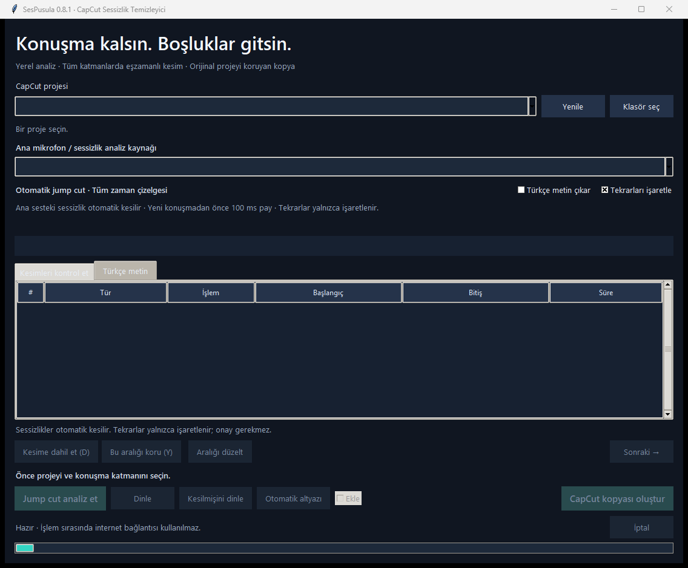

# SesPusula — Silence Cutter for CapCut

**Keep the speech. Cut the silence. Get back to creating.**

SesPusula is a desktop tool that removes silent parts from CapCut projects. It analyzes your clean microphone and applies the same cuts to every supported audio and video track. Your camera, screen recording, and microphone stay aligned.

It saves a separate project copy and keeps your original project unchanged.



*Real Windows screenshot before selecting a project. The current interface is in Turkish.*

## Why I built it

I make videos for my YouTube channel, **UlasCS**. Removing pauses from long recordings used to take hours, especially with a camera, a screen recording, and a separate microphone.

In my own UlasCS workflow, SesPusula helped bring an editing stage that used to take around **6 hours down to about 30 minutes**. It made a huge difference to how I prepare my videos and gave me more time for the creative work.

This is my personal experience, not a measured benchmark or a promise for every project. Recording length, computer speed, and the amount of manual editing affect the result.

## Features

| Feature | What it does |
| --- | --- |
| Automatic silence cuts | Finds pauses in the main microphone recording. |
| Cuts across supported tracks | Removes the same time ranges from the aligned timeline. |
| No approval queue | Lets you create the copy without approving every cut. |
| Optional review | Listen to a cut, keep an interval, or adjust its boundaries. |
| Possible repeat markers | Marks possible repeated takes without deleting spoken content. |
| Turkish subtitles | Creates editable CapCut text and an SRT file. |
| Local processing | Runs speech models locally without internet during normal analysis. |
| Original project protection | Writes a separate copy and checks the saved project data. |

## How to use it

1. Align your recordings in CapCut first. SesPusula does not synchronize recordings or change audio levels.
2. Open SesPusula and select your CapCut project.
3. Select your clean microphone as the analysis source.
4. Click **Jump cut analiz et** to analyze the whole timeline.
5. Optionally review cuts, enable Turkish subtitles, or mark possible repeats.
6. Save and close CapCut, then click **CapCut kopyası oluştur** to create the edited copy.
7. Open the new copy in CapCut, check the result, and continue editing.

Keep the source media in its original location. The new project still refers to those files.

### Cutting behavior

Silence is removed up to **100 ms before the next detected speech**. Cuts are rounded inward to full video frames, so the remaining gap can be slightly longer. Start/end silence and gaps between microphone clips are included. If no speech is detected, the entire recording is not automatically deleted.

Possible repeats become markers, never automatic deletions. Speech detection and word timing can make mistakes, so listening to the result is still part of editing.

## Installation

### Existing Windows portable package

Open **`SesPusula.exe`** or **`SesPusula.cmd`** in the complete package. A separate Python installation is not needed. Keep the folder together, including `.runtime`, `.models`, and `vendor`.

**Cloning this repository does not download the portable package.** Python binaries, model weights, bundled dependencies, and private working data are excluded from Git. This source upload does not include a downloadable portable release.

### From source — Windows

Use Python **3.11** with Tk support and FFmpeg. The existing package uses Python 3.11.9.

```powershell
git clone https://github.com/godzago/sespusula-silence-cutter.git
cd sespusula-silence-cutter
py -3.11 -m venv .venv
.\.venv\Scripts\python.exe -m pip install -r requirements-lock.txt
```

Install FFmpeg separately and make sure `ffmpeg` is available on your `PATH`. The app can also find a binary under `vendor/imageio_ffmpeg/binaries/`.

For transcription, subtitles, and repeat detection:

1. Download `config.json`, `model.bin`, `tokenizer.json`, and `vocabulary.txt` from [the pinned faster-whisper-small revision](https://huggingface.co/Systran/faster-whisper-small/tree/536b0662742c02347bc0e980a01041f333bce120).
2. Place them in `.models/whisper-small/` at the repository root.
3. Copy [docs/model-manifest.json](docs/model-manifest.json) to `.models/whisper-small/local-manifest.json`. It records the expected revision and file hashes.

The installed `faster-whisper` package supplies the Silero VAD asset. Once dependencies and models are ready, launch:

```powershell
.\.venv\Scripts\python.exe entrypoint.py
```

These instructions describe the source requirements. A fresh installation from Git has not yet been tested; the verified environment is the existing Windows portable package. Full packaging/build scripts are not included in this repository.

## Compatibility and limits

- Application version: **0.8.1**.
- Supports CapCut JSON version **360000** and one active timeline.
- Developed with Windows CapCut **9.6.0.4097**.
- Supports normal-speed audio/video, still images, and basic text tracks within its compatibility checks.
- Speed ramps, reverse playback, compound clips, keyframes, transitions, word-timed captions, and unverified effects can block output.
- Uses **Silero VAD** for speech detection and **Whisper small** for Turkish transcription on CPU/int8.
- macOS execution has not been verified. This repository comes from the Windows portable folder.
- Automated project JSON/SRT checks have passed. Those checks do not verify playback, marker/subtitle appearance, or video export inside CapCut.

SesPusula is an independent project and is not affiliated with CapCut.

## Tests

The current suite has **50 tests**, covering timeline cuts, project copies, subtitles, repeat markers, review state, and interface behavior.

Existing portable environment:

```powershell
.\.runtime\python.exe -m unittest discover -s tests -v
```

Prepared source environment:

```powershell
.\.venv\Scripts\python.exe -m unittest discover -s tests -v
```

Interface tests need a desktop session. `Kendini Test Et.cmd` provides additional runtime checks in the portable package.

## Project structure

| File | Purpose |
| --- | --- |
| `app.py` | Desktop interface |
| `silence_core.py` | CapCut projects, timeline editing, and safe copies |
| `speech_analysis.py` / `speech_worker.py` | Local speech detection and transcription |
| `jump_cut.py` | Automatic silence-cut rules |
| `review.py` | Cut selection and saved review state |
| `captions.py` | Subtitle timing, text tracks, and SRT |
| `timeline_markers.py` | Repeat markers and time mapping |
| `export_pipeline.py` | Final cuts, subtitles, and project-copy creation |
| `tests/` | Regression tests |

## Privacy and bug reports

Local settings, caches, reviews, and backups live in `.state/`. This folder is excluded from Git, along with models, bundled dependencies, and common recording formats.

For bug reports, include the application version, CapCut version, and error message. Remove personal paths and private recordings from shared examples.

Third-party notices are in [Lisanslar](Lisanslar/). A license for the application's own source code has not been selected yet.

[Turkish usage guide](docs/README.tr.md)
